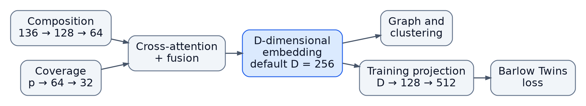

# REMAG

[](https://doi.org/10.64898/2026.03.05.709928)
[](https://doi.org/10.5281/zenodo.16762340)

**R**ecovery of **E**ukaryotic **M**etagenome-**A**ssembled **G**enomes using contrastive learning. REMAG bins eukaryotic genomes from mixed prokaryotic–eukaryotic metagenomes using sequence composition and optional coverage data.

[Installation](#installation) · [Quick Start](#quick-start) · [Usage](#usage) · [Common Options](#common-options) · [How It Works](#how-it-works) · [Output](#output) · [Troubleshooting](#troubleshooting) · [Citation](#citation)

## Installation

Requires Python 3.10+ and `miniprot` on `PATH` (not needed for `--filter-only`). The HyenaDNA classifier and marker gene database are included.

### Conda (recommended)

```bash
conda create -n remag -c conda-forge -c bioconda remag
conda activate remag
```

### PyPI

Install miniprot separately, for example with Conda:

```bash
conda create -n remag -c conda-forge -c bioconda python=3.11 pip miniprot
conda activate remag
python -m pip install remag
```

To install from source instead, run `python -m pip install .` in a clone of this repository.

### GPU acceleration

Training uses NVIDIA CUDA, then Apple Silicon MPS, then CPU. HyenaDNA filtering uses CUDA or CPU. The Docker image is CPU-only.

For NVIDIA GPUs, install CUDA-enabled PyTorch before REMAG (pick a build with the [PyTorch selector](https://pytorch.org/get-started/locally/)):

```bash
conda create -n remag-gpu -c conda-forge -c bioconda python=3.11 pip miniprot
conda activate remag-gpu
python -m pip install torch --index-url https://download.pytorch.org/whl/cu128
python -m pip install remag
python -c "import torch; print('CUDA:', torch.cuda.is_available())"
```

On Apple Silicon, `python -m pip install torch remag` in a native ARM environment enables MPS.

## Quick Start

Provide a contig FASTA and one coordinate-sorted BAM/CRAM file per sample, with reads mapped to that assembly:

```bash
remag contigs.fasta -c alignments.bam -o output_directory
```

Metagenome-assembled genomes (MAGs) are written to `output_directory/bins/` and contig assignments to `output_directory/bins.csv`. Logs are in `output_directory/remag.log`. Without `-o`, results go to `remag_output` next to the FASTA.

### Docker

```bash
docker run --rm --user "$(id -u):$(id -g)" -v "$(pwd):/data" danielzmbp/remag:latest \
  /data/contigs.fasta -c /data/alignments.bam -o /data/output
```

### Singularity

```bash
singularity build remag.sif docker://danielzmbp/remag:latest
singularity run --bind "$(pwd):/data" remag.sif \
  /data/contigs.fasta -c /data/alignments.bam -o /data/output
```

For reproducible runs, record the installed version with `remag --version`.

## Usage

```bash
# Multiple samples (or use -c samples/*.bam)
remag contigs.fasta -c sample1.bam -c sample2.bam

# Precomputed coverage: one file per sample
remag contigs.fasta -c sample1.tsv -c sample2.tsv
remag contigs.fasta -c sample1.bam.cov.gz -c sample2.bam.cov.gz

# Only run eukaryotic filtering
remag contigs.fasta --filter-only

# Keep features, model weights, and encoder embeddings
remag contigs.fasta -c alignments.bam -k

# Replace existing results
remag contigs.fasta -c alignments.bam -o output_directory --force
```

FASTA input may be gzipped. Contig IDs (the first word of each header) must be unique.

### Coverage inputs

Use one file per sample, and don't mix BAM/CRAM with precomputed coverage.

**BAM/CRAM:** coordinate-sorted alignments against the input assembly. Missing indexes are created, so pre-index files in read-only directories. If coverage runs out of memory, reduce `--threads` or `--coverage-batch-size`.

**Contig-level TSV/TXT:** whitespace-separated, no header, contig ID first and coverage last. Every fragment of a contig gets the same value.

```tsv
contig_1	12.4
contig_2	3.8
```

**Interval COV/bedGraph:** four columns, no header: contig ID, 0-based start, exclusive end, and coverage. Missing intervals count as zero.

```tsv
ctg0	0	256	1
ctg0	256	859	2
```

Precomputed files may end in `.tsv`, `.txt`, `.cov`, `.bedgraph`, or `.bg`, optionally gzipped; the layout is detected from the contents.

### Reusing or replacing results

Rerunning into the same output directory reuses compatible results, validated against the recorded settings and inputs. If they don't match, use `--force` or a new directory. `--force` removes only REMAG's own outputs. A cached filtered FASTA is reused without reclassifying, so use `--force` after changing the input or filtering.

## Common Options

`remag -h` shows the basics; `remag --help` shows all options.

| Option | Purpose / default |
| --- | --- |
| `-c, --coverage` | One or more coverage files; optional |
| `-o, --output` | Output directory; `remag_output` next to the input FASTA |
| `-t, --threads` | CPU workers; 8 |
| `-k, --keep-intermediate` | Retain features, model weights, and encoder embeddings |
| `--force` | Remove existing outputs and recompute |
| `--filter-only` | Stop after eukaryotic filtering |
| `--save-filtered-contigs` | Also save contigs rejected by the filter |
| `--skip-bacterial-filter` | Disable HyenaDNA filtering |
| `--min-contig-length` | Minimum contig and training-fragment length; 1,000 bp |
| `--graph-min-contig-length` | Minimum length for the clustering graph; 1,000 bp with one coverage file, otherwise 3,000 bp. Shorter contigs can still join bins during rescue |
| `--min-bin-size` | Minimum exported bin size; 500,000 bp |
| `--skip-rescue` | Skip bin merging and recruitment of unassigned contigs |

Other defaults: 100 epochs, 256 embedding dimensions, 15 k-NN neighbors, and a base learning rate of `0.005` (`0.0005` with multiple coverage files). Effective settings are saved in `params.json`.

## How It Works

1. **Filter:** HyenaDNA keeps eukaryotic contigs (unless `--skip-bacterial-filter` is set).
2. **Extract features:** combine 4-mer composition with coverage, and generate training fragments from each contig.
3. **Learn embeddings:** train a Siamese network with Barlow Twins on fragments from the same contig.
4. **Annotate markers:** map eukaryotic single-copy core genes with miniprot.
5. **Cluster and rescue:** run Leiden clustering at several resolutions, guided by the markers; merge fragmented bins; recruit unassigned contigs; and apply the minimum bin size.



See the [methods guide](https://github.com/danielzmbp/remag/blob/main/docs/methods.md) for details of filtering, features, the model, clustering, and rescue.

## Output

| File | Contents |
| --- | --- |
| `bins/bin_*.fa` | Bins meeting `--min-bin-size` |
| `bins.csv` | Contig assignments for exported bins |
| `core_gene_duplication_results.json` | Marker gene counts and duplications for exported bins |
| `embeddings.csv` | Contig embeddings |
| `remag.log` | Run progress, warnings, and errors |
| `params.json` | Effective run settings |

<details>
<summary>Additional outputs</summary>

| File | Contents |
| --- | --- |
| `pre_rescue.csv` | Assignments before rescue for all admitted contigs |
| `rescue_assignments.csv` | Assignments before the size filter, with an `exported` flag |
| `knn_graph_edges.csv`, `knn_graph_contigs.csv`, `knn_graph_stats.json` | Clustering graph and its statistics |
| `gene_contig_mappings.json` | Cached marker mappings |
| `training_provenance.json`, `clustering_provenance.json` | Settings and input fingerprints used to validate reuse |
| `fragments.pkl` | Fragment sequences and coordinates |
| `*_hyenadna_classification.tsv` | Filter predictions |
| `*_eukaryotic_filtered.fasta` | Contigs kept by the filter |
| `*_non_eukaryotic.fasta` | Rejected contigs, with `--save-filtered-contigs` |

With `-k`, REMAG also keeps `features.csv`, `siamese_model.pt`, `kmer_embeddings.csv`, `coverage_embeddings.csv` (with coverage), and miniprot intermediates in `temp_gene_mapping/`.

</details>

### Visualization

From a source checkout, install the plotting extras and generate UMAP plots (`umap_coordinates.csv` and `umap_plot.pdf`):

```bash
python -m pip install -e ".[plotting]"
python scripts/plot_features.py \
  --features output_directory/embeddings.csv \
  --clusters output_directory/bins.csv \
  --output output_directory
```

## Troubleshooting

Check `remag.log` for the stage reached and any warnings or errors.

| Problem | What to check |
| --- | --- |
| No bins produced | Whether filtering kept any contigs, and whether any bin reached `--min-bin-size` (500 kb by default). |
| Too few training pairs | Training needs at least two positive fragment pairs; very small inputs may not produce enough. |
| Coverage runs out of memory | Reduce `--threads`, or `--coverage-batch-size` to limit queued work. |

## Acknowledgments

The classifier builds on [HyenaDNA](https://github.com/HazyResearch/hyena-dna): Nguyen E, Poli M, Faizi M, et al. *HyenaDNA: Long-Range Genomic Sequence Modeling at Single Nucleotide Resolution.* NeurIPS 2023.

## License

[MIT](https://github.com/danielzmbp/remag/blob/main/LICENSE).

## Citation

If you use REMAG in your research, please cite:

```bibtex
@article {G{\'o}mez-P{\'e}rez2026.03.05.709928,
	author = {G{\'o}mez-P{\'e}rez, Daniel and Raguideau, S{\'e}bastien and Warring, Sally and James, Robert and Hildebrand, Falk and Quince, Christopher},
	title = {REMAG: recovery of eukaryotic genomes from metagenomic data using contrastive learning},
	elocation-id = {2026.03.05.709928},
	year = {2026},
	doi = {10.64898/2026.03.05.709928},
	publisher = {Cold Spring Harbor Laboratory},
	URL = {https://www.biorxiv.org/content/early/2026/03/08/2026.03.05.709928},
	eprint = {https://www.biorxiv.org/content/early/2026/03/08/2026.03.05.709928.full.pdf},
	journal = {bioRxiv}
}
```
